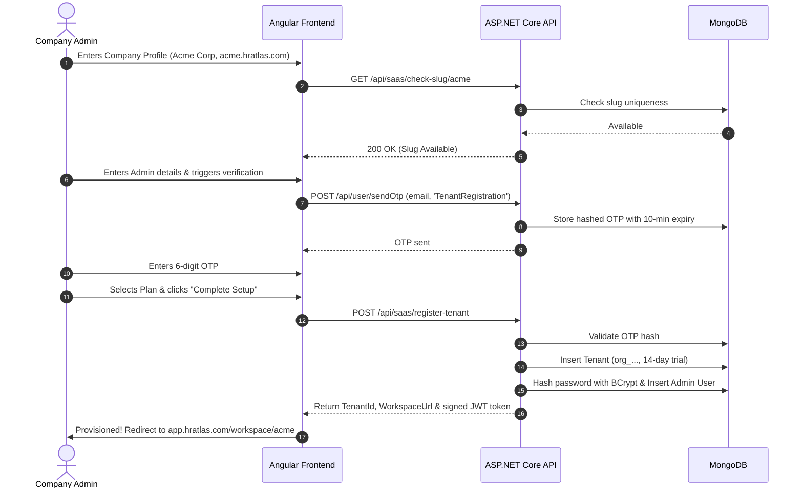

# HR Atlas – Technical Architecture & Multi-Tenant Security

## 1. System Architecture

HR Atlas is built with clean separation of concerns:
- **Frontend SPA**: Angular 16+ (Standalone Components, TypeScript, SCSS, Reactive Forms, RxJS).
- **Backend API**: ASP.NET Core on .NET 10 (`net10.0`), MongoDB (`MongoDB.Driver`), JWT Bearer Authentication, and BCrypt password hashing.

## 2. Multi-Tenant Security & Tenant Isolation

### 2.1 The Principle of Zero-Trust Client TenantId
In SaaS platforms, never trust a `TenantId` provided via request headers or body by an untrusted client.
In HR Atlas:
1. When a user authenticates via `POST /api/login` or registers via `POST /api/saas/register-tenant`, the backend issues a signed JWT token containing:
   - Claim `TenantId`
   - Claim `OrgSlug`
   - Claim `Role`
2. The `TenantContextMiddleware` extracts this claim from `ClaimsPrincipal.FindFirst("TenantId")` after signature validation with the server's symmetric secret.
3. The scoped `ITenantContext` service injects this verified identity into all data queries and mutation handlers.
4. Tenant data is isolated with unique and compound indexes in MongoDB:
   - `Tenants`: `{ tenantId: 1 }` (unique)
   - `Users`: `{ tenantId: 1, email: 1 }` (compound unique)
   - `OtpVerifications`: `{ email: 1, purpose: 1 }` (TTL expiration)

### 2.2 Onboarding Journey

## 3. Subscription & Seat Management

- **Free Trial**: Every new registration is granted a 14-day full access trial on the Growth tier.
- **Seat Limit Enforced**: `maxSeats` prevents unmetered user additions beyond subscription tier limits (15 for Starter, 50 for Growth, 1000 for Enterprise).
- **Seat Utilization Tracking**: `GET /api/saas/organisation/usage` gives live visibility into used vs remaining seats.
- **Webhook Handshake**: Payment webhooks (`payment.succeeded`, `subscription.cancelled`) are validated with cryptographic HMAC-SHA256 signatures before updating subscription state.

